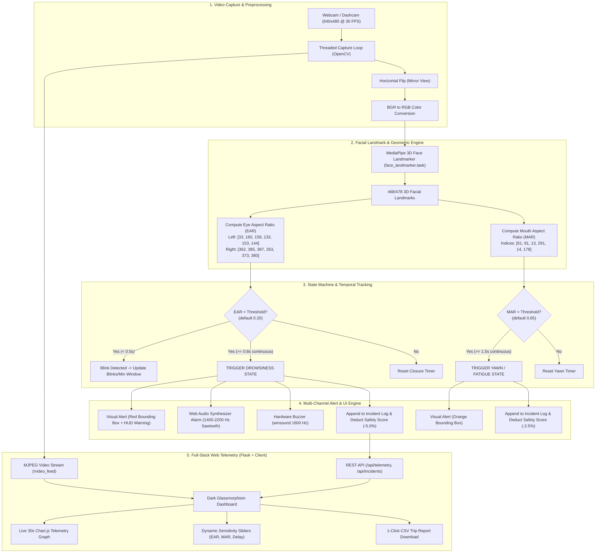
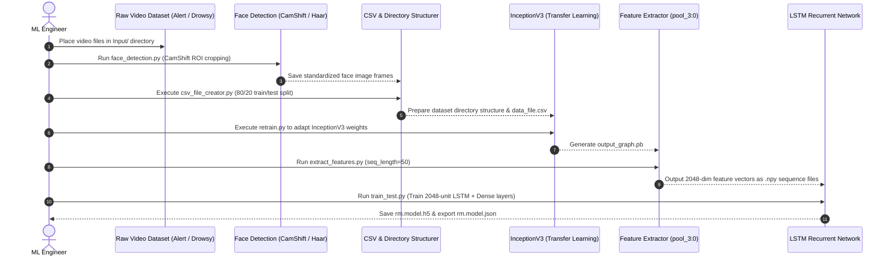

# 🚗 Comprehensive Project Technical Documentation: DriverGuard AI
## Real-Time Driver Drowsiness, Fatigue & Attentiveness Telemetry System

---

## 📑 Table of Contents
1. [Project Introduction and Problem Statement](#1-project-introduction-and-problem-statement)
2. [Technologies and Why They Were Selected](#2-technologies-and-why-they-were-selected)
3. [Architecture and Complete System Workflow](#3-architecture-and-complete-system-workflow)
4. [In-Depth Feature Breakdown](#4-in-depth-feature-breakdown)
5. [Individual Contribution & Engineering Ownership](#5-individual-contribution--engineering-ownership)
6. [Technical Concepts & Code-Level Deep Dive](#6-technical-concepts--code-level-deep-dive)
7. [Engineering Challenges Faced & Applied Solutions](#7-engineering-challenges-faced--applied-solutions)
8. [Comprehensive Interview Questions and Answers (45 Questions)](#8-comprehensive-interview-questions-and-answers)

---

## 1. Project Introduction and Problem Statement

### 1.1 Background & Real-World Motivation
Driver fatigue and micro-sleeps are among the leading causes of fatal transportation accidents worldwide:
- According to the **National Highway Traffic Safety Administration (NHTSA)**, drowsy driving is responsible for over **100,000 police-reported crashes**, **71,000 injuries**, and **over 1,550 fatalities** annually in the United States alone.
- The **World Health Organization (WHO)** identifies driver sleepiness as a primary risk factor in 20% to 30% of commercial vehicle collisions.
- At typical highway speeds ($100\text{ km/h}$ or $\approx 28\text{ m/s}$), a momentary **3-to-4 second micro-sleep** results in a vehicle traversing more than **100 meters completely unguided**—the equivalent of traversing an entire football field blindfolded.

### 1.2 The Problem Statement
Existing driver monitoring systems suffer from critical practical shortcomings:
1. **Intrusive Hardware**: Wearables such as EEG caps, smart wristbands, or physiological pulse sensors cause driver discomfort, require constant recharging, and suffer from high compliance friction.
2. **Expensive Proprietary Equipment**: Automotive OEM solutions (e.g., Mercedes Attention Assist, Cadillac Super Cruise) rely on proprietary steering torque sensors or specialized, expensive infrared sensor arrays that cannot be retrofitted into existing consumer or fleet vehicles.
3. **High Latency & Heavy Compute Constraints**: Many deep-learning computer vision prototypes run massive neural networks (e.g., standard ResNet-50 or 3D CNNs) per-frame, which requires expensive power-hungry GPUs, suffers from frame lag, and cannot deliver deterministic sub-second response times on low-power edge platforms (e.g., in-cabin Raspberry Pi or vehicle head units).
4. **Binary Without Granularity**: Traditional systems simply sound an alarm when a driver drifts out of lane (which is often too late) rather than proactively tracking continuous physiological fatigue indicators such as blink frequency degradation, yawning duration, and eye closure progression.

### 1.3 Proposed Solution: DriverGuard AI
**DriverGuard AI** is an intelligent, non-invasive, dual-pipeline driver safety ecosystem designed for edge and web deployment:
- **Zero-Latency Live Telemetry Engine**: Uses Google **MediaPipe Face Mesh (468/478 3D landmarks)** to compute the geometric **Eye Aspect Ratio (EAR)** and **Mouth Aspect Ratio (MAR)** in real time ($30+\text{ FPS}$ on standard CPU without dedicated GPU).
- **Proactive Micro-Sleep Interception**: Identifies subtle physiological markers—including gradual eye droop, prolonged closures ($> 0.8\text{s}$), yawning frequency ($> 1.5\text{s}$), and blinks per minute (BPM) anomalies.
- **Dual-Alarm Reflex Mechanism**: Combines client-side high-urgency audio synthesis via the **Web Audio API** (cross-platform, zero audio file dependencies) with host-level hardware alerts (`winsound`).
- **Interactive Telemetry Dashboard**: Modern web interface streaming real-time video, 30-second rolling Chart.js telemetry, on-the-fly sensitivity tuning, real-time safety scores ($0-100\%$), and automated CSV incident auditing.
- **Hybrid Spatio-Temporal Deep Learning Pipeline**: An offline video classifier pairing **InceptionV3 transfer learning** (extracting 2048-dimensional bottleneck features per frame) with a multi-layer **LSTM recurrent neural network** that captures continuous temporal patterns over sequential video frames.

---

## 2. Technologies and Why They Were Selected

| Technology | Category | Why It Was Chosen Over Alternatives |
| :--- | :--- | :--- |
| **Python 3.8+** | Primary Language | Rapid prototyping, native integration with machine learning/computer vision ecosystems (OpenCV, TensorFlow, MediaPipe), and cross-platform runtime support. |
| **OpenCV (`cv2`)** | Computer Vision | High-performance C++ backend with Python bindings; optimal for low-latency video I/O, BGR-to-RGB transformations, JPEG compression, and CamShift color tracking. |
| **Google MediaPipe Face Mesh** | 3D Facial Landmarking | Far superior to traditional 68-point Dlib landmarks. Dlib is sensitive to lighting, requires heavy compute, and often fails on profile head poses. MediaPipe infers **478 3D facial landmarks** on CPU in under $15\text{ms}$ with sub-millimeter precision, making it ideal for edge deployment. |
| **TensorFlow / Keras** | Deep Learning Framework | High-level API for model composition, pre-trained weights for transfer learning, checkpointing, and simple serialization of computational graphs. |
| **InceptionV3 (CNN)** | Feature Extraction | Leverages factorized $7\times 7$ convolutions, asymmetric filters, and spatial pooling. Extracting features from the `pool_3:0` bottleneck layer yields a compact 2048-dimensional embedding capturing facial expressions without re-training convolutional layers from scratch. |
| **LSTM (Long Short-Term Memory)** | Recurrent Neural Network | Mitigates the vanishing gradient problem inherent in vanilla RNNs. Driver drowsiness is an inherently temporal process (a single closed frame is a blink; multiple consecutive closed frames represent a micro-sleep). LSTM retains historical temporal context across multi-frame sequences. |
| **Flask (Python WSGI)** | Web Backend | Minimalist, thread-safe, and low-overhead microframework. Easily handles multi-threaded camera acquisition, multipart MJPEG streaming (`multipart/x-mixed-replace`), and RESTful JSON telemetry endpoints. |
| **HTML5 / CSS3 (Glassmorphism)** | Frontend UI | Clean dark-mode interface built with CSS custom properties, backdrop blur filters, and flex/grid layouts. Designed to emulate modern automotive heads-up cockpit displays. |
| **Chart.js** | Live Telemetry Graph | Hardware-accelerated HTML5 Canvas rendering. Capable of smoothly redrawing 30-second sliding windows of dual continuous variables (EAR and MAR) at high frequencies without browser thread blocking. |
| **Web Audio API** | Audio Alert Synthesis | Generates dynamic two-tone frequency sweeps ($1400\text{ Hz} \to 2200\text{ Hz}$) dynamically via software oscillators. Eliminates broken static MP3 paths, bypasses OS audio driver incompatibilities, and complies with modern browser security policies. |
| **NumPy & Pandas** | Vectorized Math & Data | Accelerated vector Euclidean distance operations for landmark aspect ratios; structured DataFrame management for sequence splitting and CSV telemetry logs. |

---

## 3. Architecture and Complete System Workflow

### 3.1 High-Level Architecture Overview
The system contains two distinct, complementary subsystems:
1. **Real-Time Edge Detection & Telemetry Subsystem** (`app.py`, `live_detection.py`): Zero-latency, landmark-based pipeline for real-time monitoring and warning generation.
2. **Deep Spatio-Temporal Model Subsystem** (`extract_features.py`, `models.py`, `train_test.py`): Offline sequence modeling pipeline using CNN bottleneck embeddings and recurrent neural networks.



---

### 3.2 Deep Learning Pipeline Workflow (InceptionV3 + LSTM)

When training the spatio-temporal deep neural network on video sequences:



---

## 4. In-Depth Feature Breakdown

### 4.1 Real-Time 3D Facial Landmark Tracking
- Utilizes Google's `face_landmarker.task` bundle running on the MediaPipe Tasks Vision runtime.
- Evaluates **478 3D landmarks** with normalized screen coordinates $(x, y, z)$.
- Sub-pixel tracking ensures landmark stability even when the driver rotates their head, tilts, or speaks.

### 4.2 Eye Aspect Ratio (EAR) & Micro-Sleep Tracking
- Extracts 6 cardinal coordinates per eye (corners, upper eyelids, lower eyelids).
- Computes Euclidean distance ratio between vertical eyelid opening and horizontal eye width.
- Incorporates a continuous time buffer: when $\text{EAR} < \text{threshold}$ (default $0.20$), a high-resolution timer measures continuous closure duration:
  - Normal blink: $150\text{ms} - 400\text{ms}$ duration $\to$ marked as normal blink.
  - Micro-sleep: $\ge 0.8\text{s}$ continuous closure $\to$ triggers red screen flash, visual banner, and continuous high-pitch alarm.

### 4.3 Mouth Aspect Ratio (MAR) & Yawning Identification
- Extracts 6 distinct mouth coordinates (commissures of the lips, upper vermilion border, lower vermilion border).
- Measures vertical mouth opening divided by inter-commissural width.
- Sustained high MAR ($> 0.65$ for $\ge 1.5\text{ seconds}$) flags fatigue/yawning, avoiding false alerts from regular speech.

### 4.4 Continuous Blink Rate Analysis (BPM)
- Employs a sliding time window (via Python's `collections.deque(maxlen=200)` and JavaScript client-side timestamp array) tracking blinks within the last 60 seconds.
- Normal human blink frequency is typically **12–20 blinks per minute**. Rapid spike ($> 30\text{ BPM}$) or sudden cessation ($< 5\text{ BPM}$) indicates visual fatigue and impending drowsiness.

### 4.5 Dual-Channel Audio Warning Engine
- **In-Browser Web Audio Synthesizer**: Uses Web Audio API oscillator nodes configured with a `sawtooth` waveform ramping rapidly from $1400\text{ Hz}$ to $2200\text{ Hz}$. This piercing, non-ignorable alert sounds directly in the driver's browser or infotainment display without depending on local audio files.
- **Native OS Buzzer**: Uses Python `winsound.Beep(1600, 150)` as a fallback for embedded headless or desktop runtime environments.

### 4.6 Interactive Glassmorphism Dashboard
- **Live Video Viewport**: Displays MJPEG video stream with dynamic HUD overlays (bounding box, EAR pill, MAR pill, and closure timer).
- **Chart.js Rolling Window**: Real-time dual line chart showing the last 30 seconds of EAR and MAR trajectories alongside threshold lines.
- **Dynamic Sensitivity Sliders**: Real-time adjustment of:
  - *EAR Threshold* ($0.12 - 0.32$): Calibrates for different eye shapes and eyeglasses.
  - *Alarm Delay* ($0.4\text{s} - 2.5\text{s}$): Controls drowsiness sensitivity.
  - *MAR Threshold* ($0.45 - 0.85$): Calibrates for yawning sensitivity.
  - *Audio Toggle*: Enables or disables audio alarm alerts.
- **Dynamic Safety Scoring ($0-100\%$)**: Starts at $100\%$; deducts $5.0\%$ for high-severity micro-sleep incidents and $2.5\%$ for yawning events.
- **Trip Incident Logging & 1-Click CSV Export**: Logs timestamp, event type, severity, duration, and instantaneous EAR/MAR values, downloadable as an audit-ready CSV file.

---

## 5. Individual Contribution & Engineering Ownership

As the developer of this project, my individual contributions spanned the entire lifecycle:

1. **System Architecture Design**:
   - Designed the dual-pipeline strategy: recognized that running a heavy CNN-LSTM network per frame on real-time video causes unacceptable latency on standard consumer hardware.
   - Decoupled real-time live monitoring (MediaPipe Face Mesh + geometric EAR/MAR running at $30+\text{ FPS}$ on CPU) from the offline spatio-temporal video classification pipeline.

2. **Computer Vision & Geometric Metric Engineering**:
   - Implemented vectorized Euclidean distance algorithms for both 6-point eye landmarks and 6-point mouth landmarks using NumPy.
   - Identified and mapped the optimal MediaPipe 3D landmark indices for the left eye, right eye, and mouth contours.

3. **Temporal State Machine & Heuristics**:
   - Engineered the non-blocking temporal tracking logic to distinguish between involuntary physiological blinks ($< 0.5\text{s}$) and dangerous micro-sleeps ($\ge 0.8\text{s}$).
   - Created the 60-second sliding window deque algorithm to accurately calculate live Blinks Per Minute (BPM).
   - Designed the dynamic Driver Safety Scoring algorithm ($100\%$ base minus weighted penalties).

4. **Full-Stack Web Application Development**:
   - Built the multi-threaded Flask backend with `threading.Lock` mechanisms to prevent race conditions across camera acquisition and client requests.
   - Implemented the low-latency multipart/x-mixed-replace MJPEG video streaming route.
   - Created the glassmorphism dark-mode UI with vanilla HTML5/CSS3 and JavaScript (ES6+).
   - Engineered the client-side Web Audio API synthesizer for zero-dependency sound alerts.
   - Integrated Chart.js to visualize live rolling telemetry curves.

5. **Deep Learning Pipeline Development**:
   - Implemented face ROI tracking using Haar Cascades and CamShift color histograms (`face_detection.py`).
   - Built the automated data preparation script (`csv_file_creator.py`) to structure video datasets and create stratified splits.
   - Engineered the bottleneck feature extraction script (`extract_features.py`) using InceptionV3's `pool_3:0` tensor.
   - Formulated and trained the multi-layer LSTM model (`models.py`, `train_test.py`) with dropout regularization to prevent overfitting on sequential features.

---

## 6. Technical Concepts & Code-Level Deep Dive

### 6.1 Mathematical Formulation of Eye Aspect Ratio (EAR)
Originally introduced by Tereza Soukupová and Jan Čech (2016), the Eye Aspect Ratio represents the ratio of the vertical distance between the eyelids to the horizontal distance between the eye corners:

$$\text{EAR} = \frac{||p_2 - p_6|| + ||p_3 - p_5||}{2 \cdot ||p_1 - p_4||}$$

Where:
- $p_1, p_4$ are the outer and inner horizontal corners of the eye.
- $p_2, p_6$ are the upper and lower outer vertical eyelid points.
- $p_3, p_5$ are the upper and lower inner vertical eyelid points.
- $||\cdot||$ denotes the standard Euclidean distance:

$$\text{dist}(p_a, p_b) = \sqrt{(x_a - x_b)^2 + (y_a - y_b)^2}$$

```
        p2       p3
         •───────•
        /         \
  p1   •           •   p4
        \         /
         •───────•
        p6       p5
```

**Key Properties of EAR**:
1. **Scale-Invariance**: Dividing by the horizontal distance $||p_1 - p_4||$ normalizes for the distance between the driver's face and the camera lens.
2. **Dynamic Range**: An open eye typically exhibits $\text{EAR} \in [0.28, 0.38]$, whereas a closed eye drops sharply to $\text{EAR} < 0.20$.

#### Code Implementation (`app.py`, lines 97–106):
```python
def calculate_ear(self, landmarks, eye_indices, img_w, img_h):
    # Convert normalized coordinates to pixel coordinates
    pts = [np.array([landmarks[idx].x * img_w, landmarks[idx].y * img_h]) for idx in eye_indices]
    p1, p2, p3, p4, p5, p6 = pts
    dist_v1 = np.linalg.norm(p2 - p6)  # Outer vertical
    dist_v2 = np.linalg.norm(p3 - p5)  # Inner vertical
    dist_h = np.linalg.norm(p1 - p4)   # Horizontal corner-to-corner
    if dist_h == 0:
        return 0.0
    return (dist_v1 + dist_v2) / (2.0 * dist_h)
```

### 6.2 Mathematical Formulation of Mouth Aspect Ratio (MAR)
Similarly, the Mouth Aspect Ratio measures vertical opening relative to horizontal lip width:

$$\text{MAR} = \frac{||m_2 - m_6|| + ||m_3 - m_5||}{2 \cdot ||m_1 - m_4||}$$

Where $m_1, m_4$ are the lip corners (indices 61 and 291) and $m_2, m_3, m_5, m_6$ are vertical lip boundary coordinates (indices 81, 13, 14, 178). Under normal talking or closed mouth conditions, $\text{MAR} \le 0.35$. During a yawn, $\text{MAR}$ spikes to $\ge 0.65$.

### 6.3 MediaPipe 3D Landmark Indices Mapping
```
Left Eye:   [33, 160, 158, 133, 153, 144]
Right Eye:  [362, 385, 387, 263, 373, 380]
Mouth:      [61, 81, 13, 291, 14, 178]
```

### 6.4 The Threaded Vision Engine (`DriverMonitor` class)
To prevent webcam frame acquisition from blocking Flask HTTP worker threads, a dedicated background daemon thread runs continuously:
- `self.lock = threading.Lock()` guarantees atomic reads and updates on shared telemetry state.
- `_capture_loop()` continuously fetches raw frames, runs MediaPipe inference, calculates EAR/MAR, updates blink counters, and encodes the resulting annotated image into JPEG bytes:
```python
ret_enc, buffer = cv2.imencode('.jpg', frame, [int(cv2.IMWRITE_JPEG_QUALITY), 80])
if ret_enc:
    self._current_frame_bytes = buffer.tobytes()
```
- In `generate_frames()`, generator yields HTTP multipart boundaries:
```python
yield (b'--frame\r\n'
       b'Content-Type: image/jpeg\r\n\r\n' + frame_bytes + b'\r\n')
```

### 6.5 Deep Learning Pipeline: InceptionV3 Bottleneck + LSTM

#### 1. InceptionV3 Feature Extraction (`extract_features.py`)
Instead of retraining all 23 million weights of InceptionV3, the frozen pre-trained graph is executed up to the penultimate global pooling layer (`pool_3:0`):
- Input: Cropped face ROI ($299 \times 299 \times 3$).
- Output: 2048-dimensional dense vector representing high-level facial representations.

#### 2. Recurrent Sequence Model (`models.py`)
```python
model = Sequential()
model.add(LSTM(2048, return_sequences=True, input_shape=(seq_length, 2048), dropout=0.5))
model.add(Flatten())
model.add(Dense(1024, activation='relu'))
model.add(Dense(512, activation='relu'))
model.add(Dropout(0.5))
model.add(Dense(nb_classes, activation='softmax'))
```
- **Input Shape**: `(sequence_length, 2048)` where `sequence_length = 50` consecutive frames.
- **LSTM Layer**: 2048 hidden units with recurrent dropout ($0.5$) to learn temporal transitions between alert and drowsy states.
- **Dense Layers**: 1024 and 512 units with ReLU activation and dropout.
- **Output Layer**: 2 classes (`Alert`, `Drowsy`) with Softmax activation trained via Categorical Crossentropy.
- **Optimizer**: Adam with learning rate $\alpha = 0.00005$ to prevent catastrophic forgetting.

---

## 7. Engineering Challenges Faced & Applied Solutions

### Challenge 1: High Computational Latency on Edge Hardware
- **Problem**: Running a full deep CNN model per video frame saturated CPU usage ($> 95\%$) and dropped video throughput to $< 8\text{ FPS}$, making micro-sleep detection dangerously delayed.
- **Solution**: Adopted a dual-engine architecture. For live inferencing, we deployed Google MediaPipe Face Mesh, which runs sub-millisecond quantized inference, maintaining $30+\text{ FPS}$ on standard multicore CPUs with $< 20\%$ CPU overhead. The CNN-LSTM model is reserved for offline sequence analysis and verification.

### Challenge 2: Distinguishing Involuntary Blinks from Dangerous Micro-Sleeps
- **Problem**: An instantaneous drop in EAR occurs during every normal blink, causing persistent false alarms if evaluated frame-by-frame.
- **Solution**: Engineered a temporal state machine with timestamp thresholds:
  - When $\text{EAR} < \text{threshold}$, record the closure start time ($t_{\text{start}}$).
  - If the eye reopens within $t < 0.6\text{s}$, increment the total blink counter and log the blink timestamp into a rolling 60-second deque.
  - If continuous closure exceeds $t \ge 0.8\text{s}$, transition state to `DROWSY WARNING` and fire the alarm.

### Challenge 3: Morphological and Lighting Variations Among Drivers
- **Problem**: Natural eye shapes vary significantly across individuals; people with naturally narrower palpebral fissures or those wearing glasses frequently triggered false drowsiness alerts under a fixed threshold ($0.25$).
- **Solution**: Added dynamic UI sensitivity sliders that communicate via `/api/settings` REST endpoints. This allows live calibration of EAR ($0.12 - 0.32$), MAR ($0.45 - 0.85$), and alarm latency ($0.4\text{s} - 2.5\text{s}$) without restarting the server. Furthermore, normalization in the EAR formula ($2 \cdot ||p_1 - p_4||$) inherently provides scale invariance against camera distance.

### Challenge 4: Modern Web Browser Audio Autoplay Policy
- **Problem**: Browsers (Chrome, Edge, Firefox) block programmatic audio playback if the user has not interacted with the DOM, preventing audio alarms from sounding when drowsiness occurs.
- **Solution**: Built an on-demand `AlarmSynthesizer` using the Web Audio API. When the user clicks "Start Camera Stream" or "Test Audio Alarm", the `AudioContext` is created or resumed within a valid user gesture event loop. When drowsiness is detected, oscillator nodes generate the alarm sweep programmatically without relying on HTML5 `<audio>` tags.

### Challenge 5: Multi-Threaded Concurrency in Video Streaming
- **Problem**: Multiple browser connections or simultaneous REST polling requests to `/api/telemetry` caused race conditions and frame corruption when reading OpenCV frame buffers.
- **Solution**: Encapsulated the camera capture loop in a dedicated background worker thread with `threading.Lock()` synchronizing buffer writes and telemetry state updates.

---

## 8. Comprehensive Interview Questions and Answers

### Category A: Project Overview & System Design (Questions 1–10)

#### Q1: Can you give an executive summary of your Driver Drowsiness Detection System?
**Answer:**
DriverGuard AI is a real-time computer vision and machine learning safety system designed to detect driver fatigue and micro-sleeps. It uses Google MediaPipe Face Mesh to extract 478 3D facial landmarks and compute scale-invariant metrics: Eye Aspect Ratio (EAR) for micro-sleep detection and Mouth Aspect Ratio (MAR) for yawning detection. The system features a responsive, glassmorphism web telemetry dashboard built with Flask, Chart.js, and the Web Audio API, delivering live video streaming, rolling telemetry graphs, dynamic sensitivity tuning, and CSV trip report logging at $30+\text{ FPS}$ on standard CPU hardware. Additionally, the repository includes an end-to-end deep learning pipeline combining InceptionV3 transfer learning and an LSTM network for spatio-temporal video sequence classification.

#### Q2: What inspired this project, and what core problem does it solve?
**Answer:**
Drowsy driving causes thousands of deaths globally every year. At highway speeds, a 3-second micro-sleep leaves a vehicle uncontrolled for nearly 100 meters. Existing commercial systems are either tied to expensive high-end vehicles or rely on intrusive wearables. Our project solves this by delivering a low-cost, non-invasive, software-driven edge solution that can run on any consumer hardware or dashboard camera with zero proprietary sensors.

#### Q3: Why did you choose a hybrid approach (MediaPipe + Geometric EAR alongside CNN + LSTM)?
**Answer:**
Real-world driver monitoring demands both sub-second responsiveness and deep behavioral understanding:
1. **Geometric MediaPipe Pipeline**: Provides deterministic, ultra-low latency ($< 15\text{ms}$) inference with minimal CPU overhead, making it ideal for immediate micro-sleep alerts in production.
2. **CNN + LSTM Pipeline**: Captures higher-level temporal patterns across long frame sequences, modeling subtle behavioral changes (e.g., slow eyelid drooping, head nodding, and gaze aversion) that simple aspect ratios might overlook.

#### Q4: What are the primary functional modules of the codebase?
**Answer:**
- `app.py`: Flask web server, threaded video capture, REST telemetry endpoints, and streaming logic.
- `live_detection.py`: Standalone desktop OpenCV application with direct `winsound` audio alerts.
- `templates/index.html` & `static/js/dashboard.js`: Responsive dark-mode dashboard, Chart.js telemetry integration, and Web Audio API alarm synthesizer.
- `face_detection.py`: Haar Cascade & CamShift face detection and ROI cropping utility.
- `csv_file_creator.py`: Automated dataset structuring and train/test partition generator.
- `extract_features.py`: InceptionV3 bottleneck feature extraction (`pool_3:0` 2048-dim vectors).
- `models.py` & `train_test.py`: Keras LSTM architecture definition, training, evaluation, and serialization.

#### Q5: How does the system handle deployment on platforms without a dedicated GPU?
**Answer:**
The live detection engine uses MediaPipe Face Landmarker, which is optimized with XNNPACK/TFLite CPU delegates. It bypasses heavy per-frame convolutional neural network inference by computing geometric aspect ratios on 3D coordinates. As a result, the entire live telemetry dashboard maintains $30+\text{ FPS}$ on standard Intel/AMD consumer CPUs or ARM-based devices (e.g., Raspberry Pi 4).

#### Q6: How does the system stream live video over the web?
**Answer:**
The system uses the HTTP standard **MJPEG (Motion JPEG)** over a multipart stream (`multipart/x-mixed-replace; boundary=frame`). The OpenCV capture loop continuously compresses annotated BGR frames into JPEG byte buffers. A Python generator (`generate_frames()`) yields each image delimited by MIME boundaries. The browser displays this stream natively inside a standard `` tag without requiring WebRTC or external plugins.

#### Q7: How does the frontend stay synchronized with backend telemetry data?
**Answer:**
The frontend dashboard executes an asynchronous HTTP polling loop (`fetch('/api/telemetry')`) every $150\text{ms}$. The returned JSON payload provides instantaneous values for EAR, MAR, blink counts, blinks per minute, safety score, and driver status. These values dynamically update the UI cards, progress bars, and Chart.js datasets.

#### Q8: What safety scoring algorithm did you implement?
**Answer:**
The driver begins each trip with a $100.0\%$ safety score. When an incident is logged:
- High Severity (Micro-sleep / closed eyes $\ge 0.8\text{s}$): $-5.0\%$ deduction.
- Medium Severity (Yawning / mouth wide open $\ge 1.5\text{s}$): $-2.5\%$ deduction.
The score is clamped at $0.0\%$ minimum and provides an objective benchmark for driver evaluation at the end of a trip.

#### Q9: What happens when the driver looks away or leaves the camera frame?
**Answer:**
If MediaPipe detects zero faces in the current frame, the system transitions to `NO FACE DETECTED`. The closure and yawn timers immediately reset to prevent false duration accumulation. The UI updates the status indicator to a neutral gray state and displays a warning prompt on the HUD.

#### Q10: How is incident data exported for fleet management or compliance?
**Answer:**
Every detected micro-sleep and yawn event is appended to an in-memory chronological incident log containing an incident ID, timestamp, event type, severity, details string, and instantaneous EAR/MAR values. Clicking "Export CSV" queries `/api/trip/export`, which formats the log using Python’s `csv` module and streams an attachment download with a dynamically generated filename (`driver_safety_report_YYYYMMDD_HHMMSS.csv`).

---

### Category B: Computer Vision & Mathematical Formulations (Questions 11–20)

#### Q11: Explain the mathematical intuition behind the Eye Aspect Ratio (EAR).
**Answer:**
EAR is a dimensionless scalar representing eyelid separation normalized by eye width:
$$\text{EAR} = \frac{||p_2 - p_6|| + ||p_3 - p_5||}{2 \cdot ||p_1 - p_4||}$$
The numerator sums two vertical chords across the pupil, while the denominator measures the horizontal length between the outer and inner canthi (corners) scaled by 2. When the eye is open, the ratio is large ($\approx 0.30 - 0.35$). When the eyelid closes, the vertical chords approach zero while the horizontal distance remains constant, causing EAR to drop toward zero.

#### Q12: Why do we use two vertical distances in the EAR numerator instead of just one?
**Answer:**
Eyelids do not close uniformly as flat horizontal lines; they curve across the eyeball. Measuring two distinct vertical chords ($p_2 - p_6$ and $p_3 - p_5$) accounts for eyelid curvature and asymmetric eye closure, significantly improving stability compared to a single mid-point measurement.

#### Q13: How does EAR achieve scale invariance?
**Answer:**
Because the vertical distance is divided by the horizontal eye length ($||p_1 - p_4||$), any linear scaling of the face—such as moving closer to or farther from the camera—scales both numerator and denominator by the exact same factor $k$. Thus, $\frac{k \cdot \text{vertical}}{k \cdot \text{horizontal}} = \frac{\text{vertical}}{\text{horizontal}}$, making EAR independent of the driver’s distance from the lens.

#### Q14: How does Mouth Aspect Ratio (MAR) work?
**Answer:**
MAR follows the same geometric principle applied to the lips:
$$\text{MAR} = \frac{||m_2 - m_6|| + ||m_3 - m_5||}{2 \cdot ||m_1 - m_4||}$$
Where $m_1, m_4$ are the lip corners and $m_2, m_3, m_5, m_6$ are top and bottom vermilion border landmarks. During speech or smiling, MAR typically stays below $0.40 - 0.50$. During an involuntary deep yawn, the mouth opens widely and vertically, driving MAR well above $0.65$.

#### Q15: Why use MediaPipe Face Mesh over traditional 68-point Dlib?
**Answer:**
1. **Landmark Density**: MediaPipe outputs 468/478 3D points, offering much finer topological granularity around the eyes and lips than Dlib's 68 points.
2. **Speed & Efficiency**: MediaPipe's lightweight neural pipeline is optimized for mobile/CPU inference using WebAssembly and TFLite, running 2-3x faster than Dlib on standard CPUs.
3. **Robustness to Pose**: Dlib’s HOG + linear SVM detector frequently drops tracking when the face rotates $> 30^\circ$, whereas MediaPipe maintains accurate tracking even under significant yaw and pitch.

#### Q16: How does the CamShift algorithm in `face_detection.py` operate?
**Answer:**
**CamShift (Continuously Adaptive MeanShift)** is a color-based object tracking algorithm:
1. Converts the initial face region from BGR to HSV color space.
2. Generates an $H$-channel (Hue) histogram and computes a probability backprojection image.
3. Iteratively calculates the spatial center of mass within the tracking window.
4. Dynamically adjusts the size and orientation of the bounding window based on the distribution's zero-th and second-order color moments, allowing continuous face tracking across subsequent video frames.

#### Q17: Why is Haar Cascade combined with CamShift in dataset preparation?
**Answer:**
Haar Cascades provide rapid initial face localization in the first frame. However, running Haar detection on every single frame is computationally expensive and jittery. Using Haar once for initialization and CamShift for subsequent frames creates an efficient tracking pipeline for extracting cropped face ROIs.

#### Q18: What is the significance of the 60-second sliding window for Blink Rate?
**Answer:**
A simple count of total blinks fails to indicate current driver alertness. By maintaining a sliding queue of timestamps corresponding to the last 60 seconds, we compute instantaneous **Blinks Per Minute (BPM)**:
```python
now = time.time()
while self.blink_timestamps and (now - self.blink_timestamps[0] > 60.0):
    self.blink_timestamps.popleft()
self.blinks_per_minute = len(self.blink_timestamps)
```
This lets the system detect both visual fatigue spikes ($> 26\text{ BPM}$) and fixed-gaze stupor ($< 8\text{ BPM}$).

#### Q19: Why do we flip the webcam frame horizontally (`cv2.flip(frame, 1)`)?
**Answer:**
Webcams capture an unflipped perspective by default. For in-cabin interactive displays, drivers expect a natural "mirror" perspective where moving their head to the left reflects accordingly on screen.

#### Q20: What color spaces are utilized across the application, and why?
**Answer:**
1. **BGR**: OpenCV's default format for camera capture and frame encoding.
2. **RGB**: Required by MediaPipe and TensorFlow, which expect standard RGB channel ordering.
3. **HSV (Hue, Saturation, Value)**: Used in CamShift (`face_detection.py`) because separating chromaticity (Hue) from luminance (Value) makes color tracking far more robust to lighting variations.
4. **Grayscale**: Used in Haar Cascade face detection to reduce 3-channel complexity to a single intensity matrix.

---

### Category C: Deep Learning & Recurrent Sequence Modeling (Questions 21–30)

#### Q21: What is the architecture of the deep learning model defined in `models.py`?
**Answer:**
The model is a sequential deep neural network designed for sequence classification:
1. **LSTM Layer**: 2048 hidden units with input shape `(seq_length, 2048)` and recurrent dropout ($0.5$).
2. **Flatten Layer**: Flattens the recurrent temporal states.
3. **Dense Layer 1**: 1024 units with ReLU activation.
4. **Dense Layer 2**: 512 units with ReLU activation.
5. **Dropout Layer**: $50\%$ dropout rate for regularization.
6. **Output Dense Layer**: 2 units (`Alert`, `Drowsy`) with Softmax activation.
7. **Compilation**: Adam optimizer ($\alpha = 0.00005$) and Categorical Crossentropy loss.

#### Q22: Why use an LSTM network instead of a standard feedforward neural network or 2D CNN alone?
**Answer:**
Single-frame 2D CNNs lack temporal memory; they treat every video frame independently. A driver with eyes closed in one frame might simply be blinking naturally ($150\text{ms}$) or undergoing a dangerous micro-sleep ($1000\text{ms}$). An LSTM possesses internal gating mechanisms (input, forget, and output gates) and a persistent cell state that tracks historical transitions across a sequence of 50 consecutive frames, learning the temporal dynamics of falling asleep.

#### Q23: What role does InceptionV3 play in `extract_features.py`?
**Answer:**
InceptionV3 is used as a fixed feature extractor via transfer learning. We load the model pre-trained on ImageNet and tap the output of the final global average pooling layer (`pool_3:0`). Passing cropped face frames through this sub-network compresses each high-dimensional image ($299 \times 299 \times 3 \approx 268\text{k}$ values) into a dense, semantically rich 2048-dimensional feature embedding.

#### Q24: What is the benefit of saving bottleneck features as `.npy` files prior to LSTM training?
**Answer:**
Passing raw video frames through InceptionV3 during every epoch of LSTM training would require enormous computational power and memory bandwidth. By pre-extracting and caching the 2048-dimensional feature vectors as `.npy` arrays on disk, training the LSTM becomes lightweight and fast, enabling rapid hyperparameter tuning over epochs in seconds rather than hours.

#### Q25: Explain the function of the Forget Gate in an LSTM cell.
**Answer:**
The forget gate decides what proportion of past information in the cell state ($C_{t-1}$) should be discarded:
$$f_t = \sigma(W_f \cdot [h_{t-1}, x_t] + b_f)$$
Where $\sigma$ is the sigmoid function producing values between 0 (completely discard) and 1 (completely retain). In our driver monitoring context, when a driver transitions from a prolonged closed-eye state back to alert driving, the forget gate enables the network to flush the historical drowsiness context.

#### Q26: Why was Adam selected as the optimizer, and why is the learning rate set so low ($0.00005$)?
**Answer:**
Adam computes adaptive learning rates for each parameter using first and second moments of the gradients. When training dense layers on top of high-capacity recurrent models (2048 units), a high learning rate (e.g., $0.001$) causes unstable gradient updates and weight oscillations. Setting $\alpha = 0.00005$ guarantees smooth, stable convergence without destroying feature representations.

#### Q27: How does `retrain.py` perform transfer learning?
**Answer:**
`retrain.py` takes the pre-trained InceptionV3 graph, freezes early convolutional feature maps (which capture general visual primitives like edges and textures), strips the final 1000-class ImageNet classification head, and attaches a new Softmax layer matching the target classes (`Alert` vs `Drowsy`). It then optimizes the top weights on the facial dataset.

#### Q28: How do callbacks in `train_test.py` enhance training stability?
**Answer:**
- `ModelCheckpoint`: Saves the model weights to disk whenever validation loss reaches a new minimum (`save_best_only=True`), preventing loss of optimal weights.
- `EarlyStopping`: Monitors validation performance and terminates training if loss fails to improve after 5 consecutive epochs (`patience=5`), preventing overfitting.
- `CSVLogger`: Records per-epoch training/validation loss and accuracy into a timestamped CSV log file for auditing.
- `TensorBoard`: Logs activation graphs and training dynamics for visual inspection.

#### Q29: What is the purpose of Dropout ($0.5$) in both the LSTM and Dense layers?
**Answer:**
With a 2048-dimensional feature input and large hidden layers, the network could easily overfit by memorizing specific subjects' facial traits rather than learning general fatigue dynamics. Dropout randomly deactivates $50\%$ of the neurons during each training forward-backward pass, forcing the network to learn robust, distributed representations.

#### Q30: How does `csv_file_creator.py` ensure balanced data partitioning?
**Answer:**
The script scans the `Input/` folder, separates video files into `f_drowsy` and `f_alert` arrays, shuffles each array independently using `random.shuffle()`, and partitions each class according to the specified train/test ratio (e.g., $80\%$ train, $20\%$ test). This stratified sampling ensures both classes are equally represented across both training and evaluation splits.

---

### Category D: Web Engineering, Real-Time Audio & Concurrency (Questions 31–40)

#### Q31: How does the client-side Web Audio API synthesizer work in `dashboard.js`?
**Answer:**
Rather than playing an external MP3 file, `AlarmSynthesizer` generates sound dynamically in browser memory:
```javascript
const osc = this.audioCtx.createOscillator();
const gain = this.audioCtx.createGain();
osc.type = 'sawtooth';
osc.frequency.setValueAtTime(1400, now);
osc.frequency.exponentialRampToValueAtTime(2200, now + 0.15);
osc.frequency.setValueAtTime(1400, now + 0.2);
osc.frequency.exponentialRampToValueAtTime(2200, now + 0.35);
```
It builds a two-tone frequency sweep ($1400\text{ Hz} \to 2200\text{ Hz}$) using a piercing sawtooth waveform. The gain node ramps volume down quickly after $0.4\text{s}$ to prevent acoustic distortion.

#### Q32: Why is software audio synthesis superior to static audio files (`<audio src="alarm.mp3">`)?
**Answer:**
1. **Reliability**: Eliminates 404 file path errors, missing asset bugs, and codec incompatibility across operating systems.
2. **Zero Network Latency**: Audio buffers do not need to be downloaded or decoded over HTTP; sound synthesis is computed directly on the local audio hardware.
3. **Modulation**: Pitch, sweep rate, and amplitude can be dynamically modified in code (e.g., raising pitch as drowsiness duration increases).

#### Q33: How does `threading.Lock` protect state in `DriverMonitor`?
**Answer:**
In Python Flask, incoming HTTP requests (e.g., `/api/telemetry`, `/api/settings`) are serviced on worker threads separate from the background `_capture_loop` thread. If a client updates settings while the vision loop is executing, unsynchronized memory reads/writes could cause race conditions. Wrapping modifications in `with self.lock:` ensures atomic operations across threads:
```python
with self.lock:
    self.ear_threshold = float(data['ear_threshold'])
```

#### Q34: Explain how Chart.js renders real-time telemetry without leaking memory.
**Answer:**
The client maintains fixed-length circular arrays (`MAX_CHART_POINTS = 35`):
```javascript
earData.push(data.ear);
earData.shift(); // Remove the oldest point
telemetryChart.update('none'); // Update without animation overhead
```
Popping the oldest entry whenever a new value arrives keeps memory allocation constant. Calling `telemetryChart.update('none')` skips interpolation animations, allowing high-frequency ($6 - 7\text{ Hz}$) canvas repainting with zero lag.

#### Q35: How does the `/api/process_frame` endpoint support client-side camera capture?
**Answer:**
In cloud-hosted deployments (e.g., Heroku, AWS EC2) where the server has no physical access to the user's local USB webcam, the client captures frames locally via HTML5 `navigator.mediaDevices.getUserMedia`. Frames are converted to base64 JPEG strings and POSTed to `/api/process_frame`. The backend decodes the payload using `cv2.imdecode(np.frombuffer(...))`, runs landmark inference, and returns telemetry metrics via JSON.

#### Q36: How does the CSV export endpoint stream data without saving temporary files to disk?
**Answer:**
The `/api/trip/export` endpoint uses Python's in-memory `io.StringIO` buffer:
```python
output = io.StringIO()
writer = csv.writer(output)
writer.writerow(['Incident ID', 'Timestamp', 'Event Type', 'Severity', 'Details', 'EAR', 'MAR'])
for item in monitor.incidents_log:
    writer.writerow([item['id'], item['timestamp'], item['type'], item['severity'], item['details'], item['ear'], item['mar']])
response = Response(output.getvalue(), mimetype='text/csv')
response.headers['Content-Disposition'] = 'attachment; filename=driver_safety_report.csv'
return response
```
This avoids unnecessary disk I/O, prevents storage leaks, and enables instant downloads.

#### Q37: What is the role of `cv2.imencode('.jpg', frame, [int(cv2.IMWRITE_JPEG_QUALITY), 80])`?
**Answer:**
Uncompressed raw BGR video frames at $640 \times 480$ resolution require $\approx 921\text{ KB}$ per frame. At 30 FPS, streaming raw frames would saturate over $27\text{ MB/s}$ of local bandwidth. Compressing to JPEG with quality level 80 reduces frame size by over $90\%$ ($\approx 35 - 55\text{ KB}$) with no perceptible visual loss for the user or detection pipeline.

#### Q38: How does the web dashboard achieve its dark-mode glassmorphism visual style?
**Answer:**
The UI uses modern CSS3 techniques:
- `backdrop-filter: blur(16px)` to create a frosted-glass look over subtle gradient backgrounds.
- High-contrast, automotive-inspired color tokens (Emerald `#00d26a` for alert states, Amber `#ffb703` for yawns, Crimson `#ff3366` for micro-sleep alerts).
- GPU-accelerated CSS keyframe animations for the pulsating warning border (`danger-flash`).

#### Q39: What prevents the incident log from logging hundreds of alerts during a single 2-second micro-sleep?
**Answer:**
The state machine uses an edge-triggered latch flag (`_last_incident_logged_drowsy`):
```python
if self.closed_duration >= self.drowsy_time_limit:
    self.is_drowsy = True
    if not self._last_incident_logged_drowsy:
        self.drowsy_incidents_count += 1
        self.log_incident("Drowsiness Alert", "HIGH", f"Eyes closed for {self.closed_duration:.1f}s")
        self._last_incident_logged_drowsy = True
else:
    self.is_drowsy = False
    self._last_incident_logged_drowsy = False
```
An incident is logged exactly once when the threshold is first crossed. It resets only after the driver reopens their eyes, preventing alert spamming.

#### Q40: What purpose does `Procfile` serve in the repository?
**Answer:**
The `Procfile` configures production PaaS deployment (such as Heroku or Render):
```
web: gunicorn app:app
```
It instructs the host to launch the web application using Gunicorn (Green Unicorn), a production-ready WSGI HTTP server, instead of Flask's internal development server.

---

### Category E: Real-World Edge Cases, Safety & Production Deployment (Questions 41–45)

#### Q41: How does the system perform when the driver is wearing eyeglasses or sunglasses?
**Answer:**
- **Clear Eyeglasses**: MediaPipe Face Mesh is trained on diverse datasets containing prescription glasses and maintains landmark tracking around the eye frame without issue.
- **Dark Sunglasses**: Opaque lenses block visible-light optical landmarks. In an enterprise automotive deployment, this is resolved by integrating near-infrared (NIR) illuminated cameras (850nm or 940nm LEDs) that pass through tinted lenses to illuminate the driver's eyes in darkness without causing distraction.

#### Q42: What happens during night-time driving or low-light conditions?
**Answer:**
Standard visible-spectrum webcams experience sensor noise and underexposure in the dark. For 24/7 commercial automotive production, the system can pair with an inexpensive USB camera equipped with an automatic IR-cut filter and infrared LEDs, providing high-contrast facial landmarking in total darkness.

#### Q43: How does the system handle head rotation when a driver checks their side mirrors?
**Answer:**
Checking side mirrors takes between $0.4\text{s}$ and $0.7\text{s}$. Because the drowsiness threshold is configured to $\ge 0.8\text{s}$ continuous eye closure, brief mirror checks do not trigger micro-sleep alarms. Furthermore, MediaPipe 3D landmarks maintain tracking up to roughly $\pm 45^\circ$ of yaw.

#### Q44: If you had another month to work on this system, what features would you add?
**Answer:**
1. **Head Pose & Distraction Estimation**: Compute 3D Euler angles (Yaw, Pitch, Roll) using `cv2.solvePnP` to detect when a driver is looking down at a mobile phone or away from the windshield.
2. **Edge Hardware Acceleration**: Compile the model using TensorRT or OpenVINO for dedicated NPU deployment on embedded systems (e.g., NVIDIA Jetson Orin Nano).
3. **Driver Re-identification**: Add facial recognition embeddings to maintain persistent safety scores and personalized threshold profiles for different drivers in a shared fleet.

#### Q45: How would you summarize the business and safety value of this project for an engineering team?
**Answer:**
DriverGuard AI bridges the gap between academic computer vision research and real-world vehicle safety. It demonstrates how to combine geometric feature extraction for zero-latency edge inference with deep temporal recurrent networks for sequence modeling. By wrapping the detection engine in an interactive, telemetry-rich web platform with automated incident reporting, it provides a practical, low-cost solution to combat drowsy driving and save lives on the road.

---
*Documentation compiled for technical reviews, system walkthroughs, and technical viva/interview defense.*

